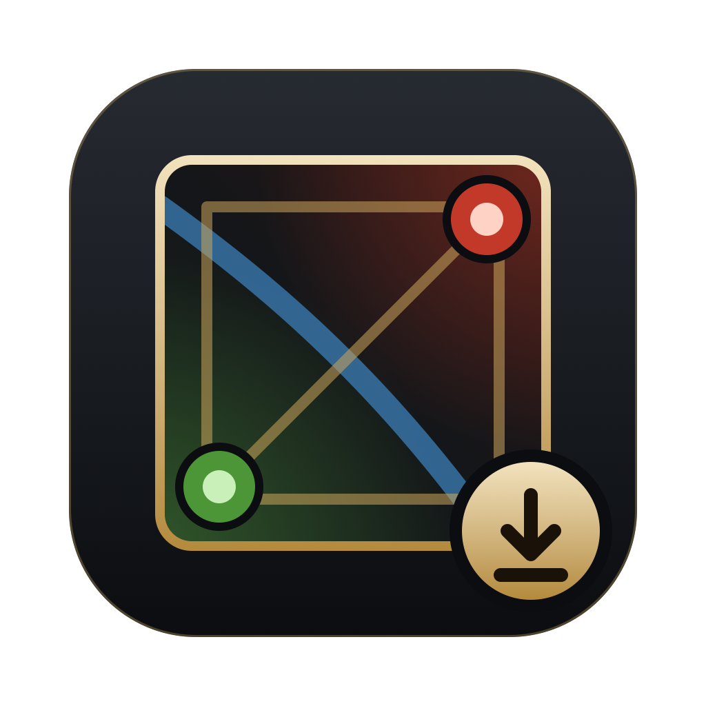

<p align="center"></p>

<h1 align="center">Toxic Dota Save</h1>

<p align="center">
  <a href="https://github.com/LiNeDante/ToxicDotaSave/releases/latest/download/ToxicDotaSave-Windows.exe"><b>⬇ Windows (.exe)</b></a>
  &nbsp;·&nbsp;
  <a href="https://github.com/LiNeDante/ToxicDotaSave/releases/latest/download/ToxicDotaSave-macOS.dmg"><b>⬇ macOS (.dmg)</b></a>
  &nbsp;·&nbsp;
  <a href="#english">English ↓</a>
</p>

## Türkçe

Dota 2 ayarlarını yedekle, istediğin Steam hesabına tek tıkla yükle. Kendi smurf hesapların ya da
arkadaşınla paylaştığın, başkasının ayarlarını bozduğu bir hesap için. Windows ve macOS, ~4 MB,
kurulum yok.

### İndir

- **Windows:** [ToxicDotaSave-Windows.exe](https://github.com/LiNeDante/ToxicDotaSave/releases/latest/download/ToxicDotaSave-Windows.exe) — indir, çift tıkla.
- **macOS:** [ToxicDotaSave-macOS.dmg](https://github.com/LiNeDante/ToxicDotaSave/releases/latest/download/ToxicDotaSave-macOS.dmg) — aç, uygulamayı **Applications**'a sürükle.

### Nasıl kullanılır?

1. Soldan hesabını seç (giriş yapılmış hesap otomatik seçili gelir).
2. **Yedekle** ile ayarlarını kaydet.
3. Yedekte **Yükle**'ye bas, hedef hesabı seç (açık ya da kapalı hesap).
4. Yüklemeden önce Dota'yı kapat.
5. Hedef hesabın eski ayarları önce otomatik yedeklenir.
6. Paylaşmak için yedek klasöründeki `.zip`'i gönder; karşı taraf **İçe aktar** ile (ya da sürükle-bırak) ekler.

Neler kaydedilir: Dota'nın hesap başına tuttuğu her şey (`Steam/userdata/<hesap>/570`) — tuş
atamaları, oyun seçenekleri, chat wheel vb. Aynı ayarlar iki kez yedeklenmez.

Yüklemeden sonra Dota açılırken Steam *bulut çakışması* sorarsa **yerel dosyaları** seç.

### İlk açılış

Uygulama yeni olduğu için ilk açılışta bir uyarı görebilirsin:

- **Windows:** "Bilgisayarınız korundu" → **Ek bilgi → Yine de çalıştır**.
  Microsoft Edge WebView2 gerekir (Windows 11'de ve güncel Windows 10'da zaten var).
- **macOS:** Applications'ta uygulamaya **sağ tık → Aç → Aç**. Bu seçenek çıkmazsa:
  Sistem Ayarları → Gizlilik ve Güvenlik → **Yine de Aç**.

Her sürüm bu repodan GitHub Actions ile derlenir ve `SHA256SUMS.txt` ile birlikte yayınlanır.

### Gizlilik

Uygulama **internete bağlanmaz**. Hesap, veri toplama, analiz ya da otomatik güncelleme yok.
Sadece Steam'in yerel dosyalarını okur ve yedekleri şuraya yazar:

- Windows: `%APPDATA%\ToxicDotaSave\backups`
- macOS: `~/Library/Application Support/ToxicDotaSave/backups`

---

## English

Back up your Dota 2 settings and load them onto any Steam account — your own smurfs, or a shared
account someone else just reconfigured. Windows and macOS, ~4 MB, no installer.

### Download

- **Windows:** [ToxicDotaSave-Windows.exe](https://github.com/LiNeDante/ToxicDotaSave/releases/latest/download/ToxicDotaSave-Windows.exe) — download and run.
- **macOS:** [ToxicDotaSave-macOS.dmg](https://github.com/LiNeDante/ToxicDotaSave/releases/latest/download/ToxicDotaSave-macOS.dmg) — open it, drag the app into **Applications**.

### How to use

1. Pick your account on the left (the logged-in one is preselected).
2. **Back up** saves your settings.
3. **Load** on a backup → choose the target account (online or offline).
4. Close Dota before loading.
5. The target's previous settings are backed up automatically first.
6. To share, send the `.zip` from the backup folder; the other person adds it with **Import** (or drag & drop).

What gets saved: everything Dota keeps per account in `Steam/userdata/<account>/570` — hotkeys,
game options, chat wheel, etc. Identical settings are never saved twice.

If Steam shows a *Cloud Sync Conflict* when Dota starts after a load, choose the **local** files.

### First launch

The app is new and builds its reputation over time, so you may see a warning once:

- **Windows:** "Windows protected your PC" → **More info → Run anyway**.
  Requires Microsoft Edge WebView2 (built into Windows 11 and current Windows 10).
- **macOS:** in Applications, **right-click the app → Open → Open**. If that's not offered:
  System Settings → Privacy & Security → **Open Anyway**.

Every release is built from this repository by GitHub Actions and ships with `SHA256SUMS.txt`.

### Privacy

The app makes **no network connections**. No accounts, telemetry, analytics or updates. It reads
Steam's local files and writes backups to:

- Windows: `%APPDATA%\ToxicDotaSave\backups`
- macOS: `~/Library/Application Support/ToxicDotaSave/backups`

The only time anything leaves your machine is when you click the credit link, which opens your browser.

### Build from source

Requires Go (see `go.mod`). The macOS build needs Xcode Command Line Tools.

```sh
./build.sh windows   # dist/ToxicDotaSave-Windows.exe (any OS)
./build.sh mac       # dist/ToxicDotaSave-macOS.dmg  (macOS, universal arm64 + x86_64)
go test .
```

UI development in a browser against a fake Steam folder (never touches real backups):

```sh
go run ./dev/fixture dev/steam
STEAM_DIR=dev/steam ACTIVE_USER=11111111 go run -tags dev .   # http://127.0.0.1:5173
```

Layout: `steam.go` (accounts), `backup.go` (zip format, restore, duplicate detection),
`api.go` (the calls the UI makes), `ui/index.html` (the whole interface), `platform_*.go` /
`main_*.go` (Windows WebView2 and macOS WKWebView shells).

---

Made by [kick.com/thetoxicparty](https://kick.com/thetoxicparty) — cowhite · [MIT License](LICENSE)

Valve Corporation ile bağlantılı değildir. / Not affiliated with Valve Corporation.
Dota 2 and Steam are trademarks of Valve Corporation.
